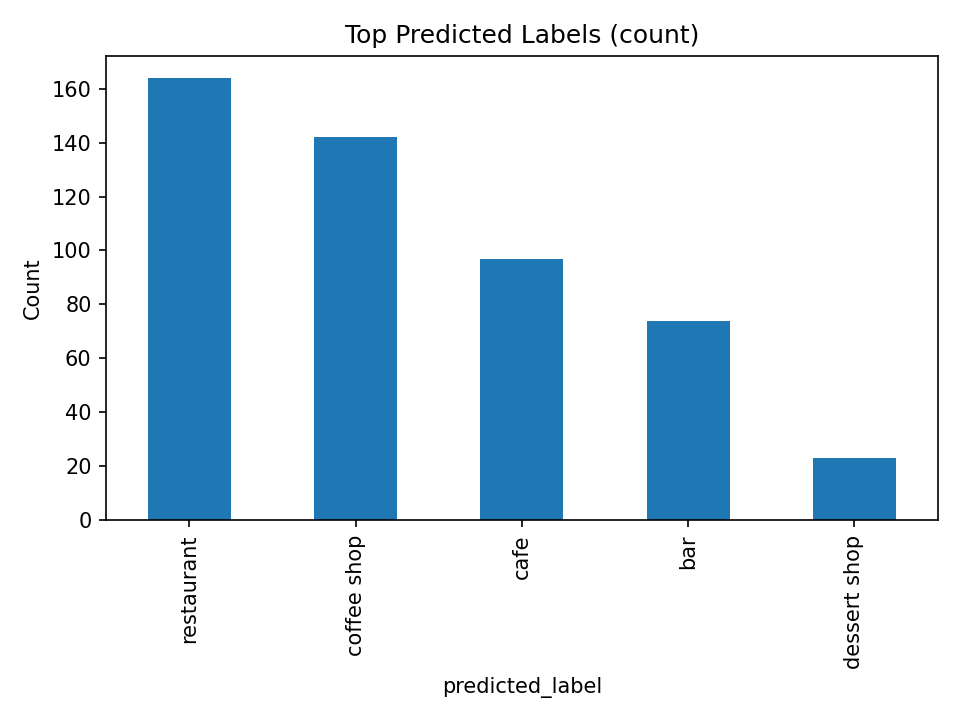
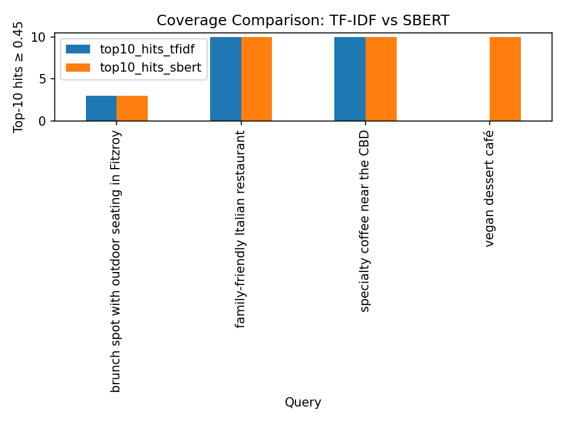

# Melbourne Cafés & Restaurants: Open Data to AI Search

**An end-to-end pipeline that turns raw OpenStreetMap data into a published dataset, AI-labelled venue categories, and a meaning-based search engine. Built with governance and compliance in mind from the start.**

- 📍 **1,896 cafés and restaurants** across Melbourne's CBD and inner suburbs, collected from OpenStreetMap
- 🤗 **Published dataset** on Hugging Face: [CITTYJAMES/melbourne-cafes-restaurants-osm](https://huggingface.co/datasets/CITTYJAMES/melbourne-cafes-restaurants-osm)
- 🏷️ **Zero-shot classification** of venue types with a Transformer model (BART-MNLI)
- 🔎 **Semantic search** with FAISS, comparing keyword matching (TF-IDF) with meaning-based search (SBERT)
- ✅ **Compliance and risk register:** ODbL licence, the Privacy Act and APPs, and documented risks with mitigations

> Developed as coursework for the Certificate IV in Data Science and AI (2025).

---

## Why I built this

I'm an avid café crawler and I love travelling. When I search for cafés or restaurants nearby, I type what I actually want, like *"open now"* or *"Instagrammable"*, and the search often returns everything nearby anyway, including places that have **permanently closed**.

I wanted to understand how search could work better: matching what a person **means**, not just the words they type, and starting from data I can trust and trace back to its source.

---

## What I built

The project follows data from its source all the way to a working search tool, in four stages:

**1. Collect and prepare the data** (`Task1_Create_Dataset/`)
Five Python scripts pull cafés and restaurants from OpenStreetMap through the Overpass API, merge the two sets and remove duplicates. They then add useful features, such as distance to the CBD, main cuisine, and Wi-Fi, outdoor seating and wheelchair access. A final validation step checks coordinates, names and website formats before saving the clean dataset, which I then published on Hugging Face.

**2. Label venues with AI** (`Task2_Transform/`)
A zero-shot Transformer model (`facebook/bart-large-mnli`) reads each venue's name and cuisine and estimates how likely it is to be a *restaurant, café, coffee shop, bar* or *dessert shop*, without any training on this dataset.

**3. Search by meaning** (`Task3_FAISS/`)
Each venue description is turned into a vector in two ways: **TF-IDF** (word matching) and **SBERT** (`all-MiniLM-L6-v2`, meaning-based). FAISS then finds the top 10 venues for realistic queries like *"vegan dessert café"* or *"brunch spot with outdoor seating in Fitzroy"*.

**4. Govern and document** (`Tasks1_4_Documentation.docx`)
Licensing, privacy and security requirements are mapped to Australian legislation and standards, with a risk register and a documented, reproducible workflow.

---

## Key results

### AI venue labels (zero-shot, sample of 500 venues)



| Predicted label | Venues | Average confidence |
|---|---|---|
| Restaurant | 164 | 0.64 |
| Coffee shop | 142 | **0.96** |
| Café | 97 | 0.67 |
| Bar | 74 | **0.23** |
| Dessert shop | 23 | 0.63 |

- **Coffee shops were the easiest to identify** (0.96 confidence), because names like "Espresso" or "Coffee Roasters" give clear clues.
- **"Bar" predictions were weak** (0.23). The model chose "bar" mostly when no label fitted well, so those labels shouldn't be trusted without review.
- **Cafés and restaurants overlap.** Many venues scored highly for both, which reflects real-world hybrid venues.

### Keyword vs meaning-based search (FAISS)



| Query | Good hits*: TF-IDF | Good hits*: SBERT |
|---|---|---|
| Brunch spot with outdoor seating in Fitzroy | 3 | 3 |
| Family-friendly Italian restaurant | 10 | 10 |
| Specialty coffee near the CBD | 10 | 10 |
| **Vegan dessert café** | **0** | **10** |

<sub>*Results in the top 10 with a similarity score of 0.45 or higher.</sub>

- **SBERT understood meaning where keywords failed.** For *"vegan dessert café"*, TF-IDF found nothing relevant, while SBERT found 10 related venues.
- **TF-IDF still did well when the query's words appear in the data**, such as "Italian" or "coffee". It even scored slightly higher on those queries.
- **Neither handled the brunch query well**, because OpenStreetMap rarely records "brunch" or outdoor seating, so the data limited both methods.

---

## How this could be used

### Data quality for location listings
Travel guides, booking and delivery platforms, and tourism boards lose trust when listings are wrong, closed or in the wrong category. This pipeline can help keep them accurate:
- **Flag listings whose category doesn't match** what the AI predicts, with confidence scores to prioritise which ones to review first.
- **Flag incomplete or doubtful records**, such as missing opening hours or contact details, or coordinates outside the expected area, using the validation checks.
- **Keep an audit trail** of where each record came from and how it changed, from raw source to clean dataset.

### For travellers
- **Café crawl and food trip planner:** suggest a route of cafés or restaurants that match a traveller's mood (*"specialty coffee"*, *"brunch with outdoor seating"*) and are close to each other, using the distance data.
- **Natural-language search in an unfamiliar city:** visitors don't know local suburb or venue names, so meaning-based search lets them ask the way they'd ask a friend.
- **Hotel and concierge recommendations:** help hotels, hostels or tour operators recommend nearby venues that match a guest's request.
- **Any city, same pipeline:** OpenStreetMap covers the whole world, so the scripts can be pointed at another city by changing the map area.

### Other business uses
- **Finding customers for suppliers:** help roasters, bakeries or equipment suppliers find and segment potential café and restaurant customers by area and type.
- **Location planning:** see venue types and cuisines per suburb to spot crowded areas and gaps.
- **Tourism and council planning:** understand the food-venue mix by area for visitor guides and precinct planning.

---

## Data governance and compliance

Open data still needs careful handling. This project documents where the data came from, how it was processed, and what risks were identified and managed.

### Legal and licensing

| Area | Requirement | How it's met |
|---|---|---|
| Licensing | Open Database Licence (ODbL 1.0) | All data is © OpenStreetMap contributors and attributed in the dataset card and here. Derived data is shared under the same licence. |
| Privacy | Privacy Act 1988 (Cth) and the Australian Privacy Principles | The data covers public business listings only, with no personal information. |
| Security | Australian Government Information Security Manual (ISM) | No API keys or credentials in the code or notebooks. |
| Research integrity | NHMRC Code for the Responsible Conduct of Research (2018) | Sources, collection date and every transformation step are documented. |

### Risk register

| Risk | Impact | Likelihood | Mitigation |
|---|---|---|---|
| Missing licence attribution | Breach of ODbL | Low | © OpenStreetMap attribution on all derived data and reports |
| Bias from short text descriptions | Wrong labels or search results | Medium | Add context fields (suburb, outdoor seating, Wi-Fi) and report confidence scores |
| Treating AI probabilities as facts | Misleading conclusions | Medium | Confidence tables and caution notes in all results |
| Data loss or file corruption | Results can't be reproduced | Medium | Raw data kept unchanged, all steps scripted, outputs archived |
| Exposed credentials or API tokens | Security risk | Low | Environment variables only, no tokens in source files |

The full assessment, including the legislation mapping, ethical principles and the reflection, is in [`Tasks1_4_Documentation.docx`](Tasks1_4_Documentation.docx).

---

## What I learned and what's next

Building this showed me how much a reliable search engine needs beyond a good model. **The search can only be as good as the data behind it.**

### Limitations

- **Missing details:** only about 23% of venues have opening hours, and few record things like outdoor seating or Wi-Fi, so many useful filters aren't possible yet.
- **Outdated listings:** OpenStreetMap is maintained by volunteers, so new venues may be missing and closed ones may still be listed.
- **Short descriptions:** most venues have just a name and a cuisine, which limits what both AI models can understand.
- **Location bias:** the CBD and inner suburbs dominate, and the data is English-only.
- **Zero-shot sample:** the classification ran on 500 venues to keep CPU run time reasonable.

### Data snapshot

The clean dataset was collected on **22 October 2025** and is the version used for all results and published on Hugging Face. OpenStreetMap changes daily, so re-running the collection scripts downloads current data, and counts may differ slightly.

### Future improvements, towards search the way I'd actually use it

- [ ] **"Open now":** combine opening hours with the current time as a filter alongside meaning-based search
- [ ] **Remove closed venues:** cross-check with fresher sources and refresh the data on a schedule
- [ ] **"Near me":** rank results by distance from the user's location
- [ ] **"Instagrammable" and other vibes:** venue names can't capture atmosphere. I considered enriching the data with reviews and social media pages, but set it aside for now: it's significant extra work, and unlike business listings, reviews are written by individuals, so privacy and platform terms of use would need careful handling.
- [ ] **More trustworthy labels:** run classification on all venues and check a sample by hand to calibrate confidence
- [ ] **Liveability features:** expand the collection area to match wider Melbourne, then combine café and restaurant density with housing data, for example as amenity scores for suburbs in my Melbourne first-home buyer project

---

## How to run it

**Requirements:** Python 3.10+. The notebooks were developed on Kaggle (CPU) but also run locally.

```bash
python -m venv .venv
source .venv/bin/activate        # Windows: .venv\Scripts\activate
pip install -r requirements.txt
```

**1. Rebuild the dataset** (run from anywhere, since the scripts find the `Data/` folder themselves):

```bash
python Task1_Create_Dataset/Task1_01_get_osm_melb_cafes.py        # download cafés
python Task1_Create_Dataset/Task1_02_get_osm_melb_restos.py       # download restaurants
python Task1_Create_Dataset/Task1_03_merge_melb_cafe_rest.py      # merge
python Task1_Create_Dataset/Task1_04_augment_melb_data.py         # add features
python Task1_Create_Dataset/Task1_05_validate_clean_melbourne.py  # validate and clean
```

> Steps 1–2 download live data, so results may differ slightly from the published snapshot (see *Data snapshot*). To reproduce the published results, skip them and start from step 3.

**2. Run the notebooks** in `Task2_Transform/` and then `Task3_FAISS/`. Task 3 rebuilds the FAISS indexes, which aren't stored in the repo.

---

## Project structure

```
├── Data/
│   ├── Raw/                  # Original Overpass API JSON (unchanged)
│   ├── Interim/              # Flattened data with added features (CSV + Parquet)
│   └── melbourne_cafes_restaurants_clean.csv   # Final dataset (published on Hugging Face)
├── Task1_Create_Dataset/     # 5 scripts: collect → merge → augment → validate
├── Task2_Transform/          # Zero-shot classification notebook + outputs
├── Task3_FAISS/              # Semantic search notebook + outputs
├── Tasks1_4_Documentation.docx   # Full report: methods, results, compliance, risk register
└── requirements.txt
```

---

## Licence and attribution

Data © OpenStreetMap contributors, available under the [Open Database Licence (ODbL 1.0)](https://opendatacommons.org/licenses/odbl/1-0/).

## Author

**Heidi Gaddi** · [GitHub](https://github.com/heidijames) · [Hugging Face](https://huggingface.co/CITTYJAMES)
